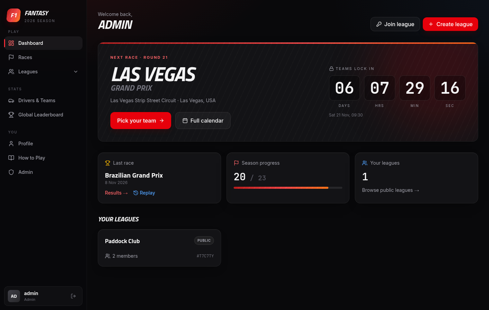
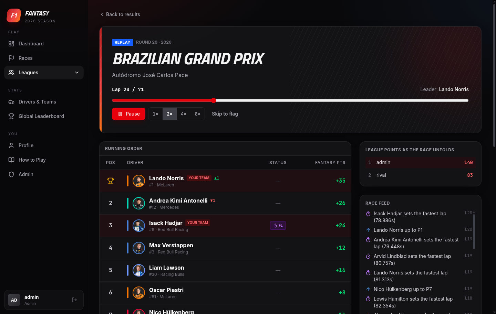
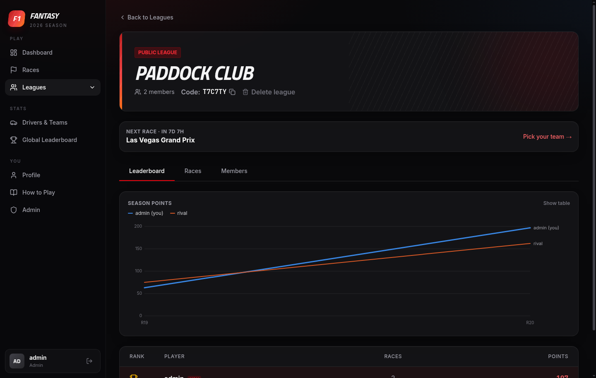
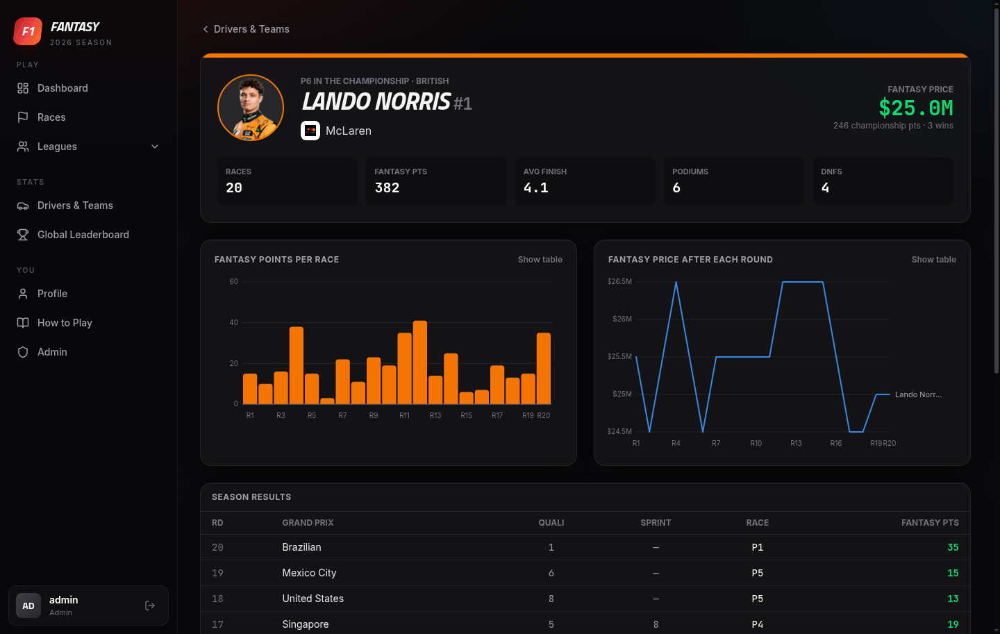
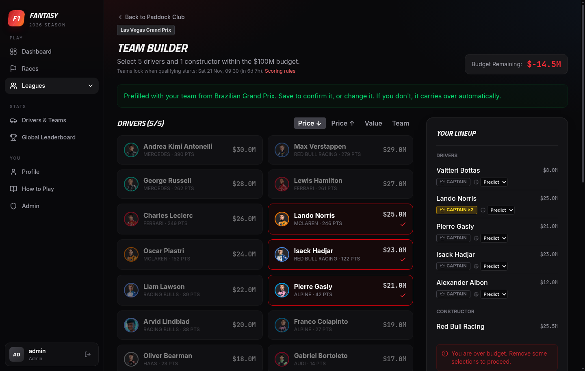

# F1 Fantasy

[](https://github.com/Floyd-Pinto/F1_Fantasy/actions/workflows/ci.yml)

A full-stack Formula 1 fantasy game built on **real F1 data**. Pick 5 drivers and a constructor under a $100M
budget, choose a captain, predict finishing positions, and compete in public or private leagues. Points come
from the official results, and every past Grand Prix can be replayed lap by lap from real timing data.



## Features
- **Real 2026 season**: calendar, drivers, teams, standings, and race, qualifying and sprint results, synced
  automatically from free public APIs. Fantasy prices follow championship form.
- **Fair, league-friendly game loop**: teams lock at the first scoring session of the weekend, so everyone in a
  league locks at the same moment. Forget to pick and your previous team carries over.
- **Deep scoring**: race, sprint and qualifying points, fastest-lap bonus, a ×2 captain, and prediction bonuses.
- **Instant results**: the server watches for official results and pushes them to every open page over
  Server-Sent Events, so points and standings update with no refresh.
- **Lap-by-lap replays** of every finished race, rebuilt from OpenF1 position and lap timing, with each league
  member's points building up as the race unfolds.
- **Lock reminders** via Web Push about an hour before teams lock.
- **Stats**: league standings charts, driver pages (season results, points per race, price history), and a
  profile with every past team and its points breakdown.
- **Admin tools**: data sync, results corrections, team principal and logo editing, user roles, and a test-race
  simulator.

| Lap-by-lap replay | League standings |
|---|---|
|  |  |
| **Driver page** | **Team builder** |
|  |  |

## Tech stack
**Frontend:** React 18, TypeScript, Vite, Tailwind CSS 4, React Router 7, dependency-free SVG charts, a service
worker for push, self-hosted fonts (Titillium Web, Inter, JetBrains Mono).
**Backend:** Node.js, Express 5, Prisma 7 (PostgreSQL), JWT auth, Server-Sent Events, Web Push (VAPID),
node-cron.
**Quality & delivery:** `node:test` unit + integration tests against real Postgres (with coverage), ESLint,
TypeScript, GitHub Actions CI, Jenkins pipeline triggered by GitHub webhooks, SonarQube quality gate, Docker.
A DevSecOps platform (Trivy, OWASP, Kubernetes/Helm, ArgoCD, Prometheus/Grafana, Vault) is designed in
[docs/DEVOPS.md](docs/DEVOPS.md).
**Data:** Jolpica-F1, OpenF1, Wikipedia.

## Quick start
```bash
docker compose up --build        # → http://localhost:8080
```
Or run each part yourself; see [docs/DEVELOPMENT.md](docs/DEVELOPMENT.md):
```bash
cd Backend && cp .env.example .env && npm install && npm run db:setup && npm run dev
cd Frontend && npm install && npm run dev      # → http://localhost:5173
```

## Documentation
| | |
|---|---|
| [Architecture](docs/ARCHITECTURE.md) | System design, race-weekend flow, live updates, folder map |
| [Scoring](docs/SCORING.md) | Every rule with a worked example |
| [API](docs/API.md) | All endpoints |
| [Database](docs/DATABASE.md) | Schema, ER diagram, migrations |
| [Data sources](docs/DATA_SOURCES.md) | What comes from where, sync schedule, rate limits, licensing |
| [Development](docs/DEVELOPMENT.md) | Setup, scripts, tests, CI |
| [Deployment](docs/DEPLOYMENT.md) | Docker Compose, free hosting |
| [DevOps](docs/DEVOPS.md) | Jenkins + SonarQube + GitHub webhooks pipeline, and the planned DevSecOps / Kubernetes / GitOps / monitoring platform |
| [Changelog](CHANGELOG.md) | What changed and why |

## Project layout
```
Backend/    Express API, Prisma schema + migrations, jobs, tests
Frontend/   React app
docs/       documentation
deploy/     server deploy script (used by Jenkins)
devops/     Jenkins setup, planned DevSecOps / Kubernetes / monitoring files
archive/    retired code kept for reference (not built)
```

---
Unofficial fan project, not associated with Formula 1 companies. Data from Jolpica-F1 and OpenF1; images from
Wikipedia/Wikimedia Commons under their licences.
