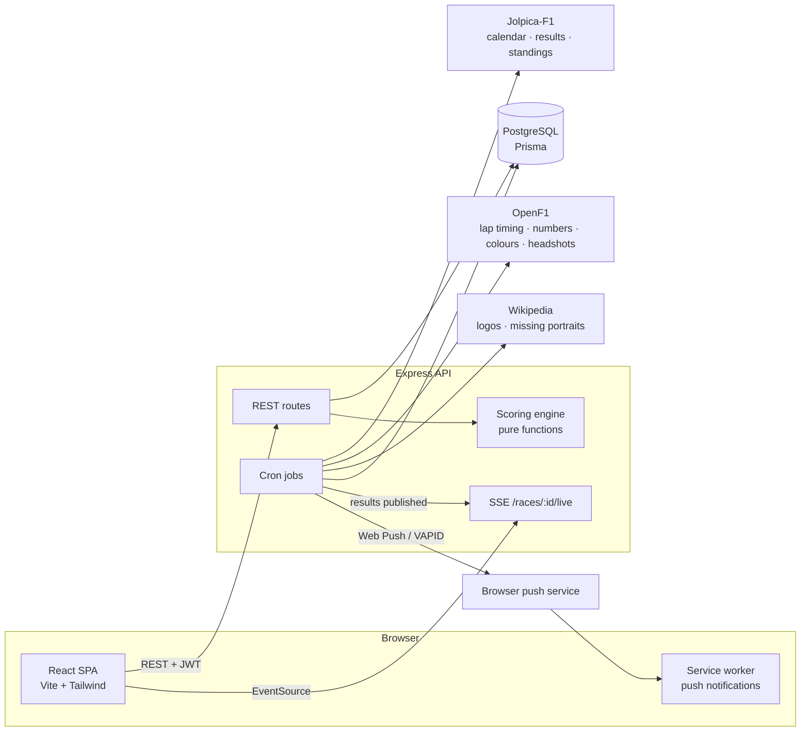

# Architecture



## Request path
`index.js` starts the server and the background jobs; `src/app.js` builds the Express app with no side effects
(tests mount it directly). Routes live in `src/api/<area>/` as `*.routes.js` + `*.controller.js`. Controllers
throw `HttpError`s for bad input; Express 5 forwards async errors to one central handler that returns
`{ error }` with the right status (and hides internals behind a generic 500).

## A race weekend, end to end
1. **Calendar sync** (`services/sync.service.js`, every 6 hours): Jolpica provides each weekend's qualifying,
   sprint and race times. `lockAt` is set to the earliest scoring session.
2. **Team building**: players pick 5 drivers + 1 constructor, a captain and optional predictions. All rules are
   enforced server-side (`api/teams/teams.controller.js`).
3. **~1 hour before lock** (`services/push.service.js`, every 5 min): players who haven't picked a team in every
   league get a Web Push notification.
4. **Lock** (`jobs/autoLock.js`, every minute): members without a team get their previous one copied in
   (*carry-over*), then every team for the race is locked.
5. **Results** (`jobs/realData.js`, every 10 min while a race awaits results): when Jolpica publishes the official
   race classification, it is imported together with qualifying and sprint results, every team is scored in one
   transaction, and a snapshot is pushed over SSE so open pages update instantly.
6. **Replay**: about 30 minutes after the flag OpenF1's timing becomes free. `services/replay.service.js` rebuilds
   the race lap by lap from position/lap data, stores the frames in `RaceReplay`, and serves them to every viewer.
   Replays are read-only; the client applies the scoring rules per lap to show how league points built up.

## Scoring
`src/scoring/scoring.js` holds every rule as pure functions (`weekendPoints`, `predictionBonus`, `scoreTeam`).
`results.service.js` loads results/teams, calls `scoreTeam` for each, and rewrites the race's `Points` rows in a
single transaction, so recalculation is idempotent and leaderboards never see half-written data. The frontend
mirrors the constants in `Frontend/src/app/scoring.ts` for replays and the rules page. See [SCORING.md](SCORING.md).

## Live updates (SSE)
`live/raceEvents.js` is an in-process pub/sub keyed by race. `GET /races/:id/live` streams JSON snapshots, sends
a heartbeat every 20 s (keeps proxies from closing idle connections) and replays the last snapshot to late
joiners. One process is assumed; scaling out would swap the EventEmitter for Postgres `LISTEN/NOTIFY` or Redis.

## Test races
`live/raceRunner.js` drives a race lap by lap from a feed (`live/feeds/simulated.js`), writing each lap and
broadcasting it. It refuses real championship races (those have a `round`) so fake results can never be scored.
On restart, races a previous process left `ONGOING` are reset.

## Frontend
React 18 + react-router 7 data router, Tailwind 4. `src/app/api.ts` wraps `fetch` with token refresh;
`hooks/useRaceStream.ts` wraps `EventSource`; `hooks/usePushReminders.ts` handles the service worker and
subscription. Charts (`components/charts.tsx`) are dependency-free SVG with hover tooltips, legends, and a table
view; the categorical palette is validated for colour-vision deficiency on the app's dark surface.

## Folder map
```
Backend/
  index.js                server + jobs
  src/app.js              Express app (routes, CORS, error handler)
  src/api/<area>/         routes + controllers (auth, users, leagues, teams, races, results, leaderboard,
                          drivers, constructors, admin, simulation, push)
  src/scoring/            scoring rules (pure)
  src/services/           sync (real data), replay, push, team info
  src/integrations/       Jolpica, OpenF1, Wikipedia clients (rate-limited)
  src/live/               SSE pub/sub, test-race runner, feeds
  src/jobs/               cron: auto-lock + carry-over, results watcher, sync, replay cache, reminders
  prisma/                 schema, migrations, seed
  test/                   node:test unit + integration tests
Frontend/
  src/app/pages/          one file per route
  src/app/components/     layout, tables, charts, shared widgets
  src/app/hooks/          SSE stream, push reminders
  public/sw.js            push service worker
docs/                     this documentation
archive/                  retired code (not built)
```
