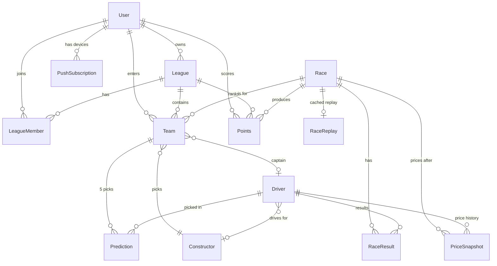

# Database

PostgreSQL via Prisma 7 (`Backend/prisma/schema.prisma`, driver adapter `@prisma/adapter-pg`).
Schema changes are versioned migrations in `Backend/prisma/migrations/`.



| Model | Notes |
|---|---|
| `User` | `role` USER/ADMIN; email unique (matched case-insensitively) |
| `League`, `LeagueMember` | 6-char join `code`; PUBLIC or PRIVATE |
| `Driver`, `Constructor` | Synced from Jolpica/OpenF1 by `externalId`; `price` from championship rank; `active` = on the current grid; `teamPrincipal`, `logoUrl` editable |
| `Race` | `round` set for real races (null = admin test race); `lockAt`, `qualifyingStart`, `sprintStart`; `openf1SessionKey` for replays; `carryOverDone` / `reminderSent` job flags |
| `Team`, `Prediction` | One team per user·race·league; `captainId`; `carriedOver`; each prediction holds an optional `predictedPosition` |
| `RaceResult` | Race finish/DNF/fastest lap + `qualiPosition`, `sprintPosition`, `sprintDnf` |
| `Points` | One row per user·race·league; `totalPts` + JSON `breakdown` (per driver: race/sprint/quali/prediction/captain) |
| `RaceReplay` | Cached lap-by-lap frames (JSON, ~20 KB per race) |
| `PriceSnapshot` | Driver price after each round |
| `PushSubscription`, `AppSetting` | Web Push devices; app-generated settings (VAPID keys) |

## Migrations
```bash
npm run migrate:dev -- --name describe_change   # create + apply a migration in development
npm run db:migrate                              # apply pending migrations (CI, Docker, production)
```
`0_init` is the baseline of the original schema; `…_gameplay_and_engagement` adds captain, predictions,
sprint/qualifying results, lock times, carry-over, price history, push subscriptions and replays.
