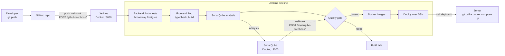
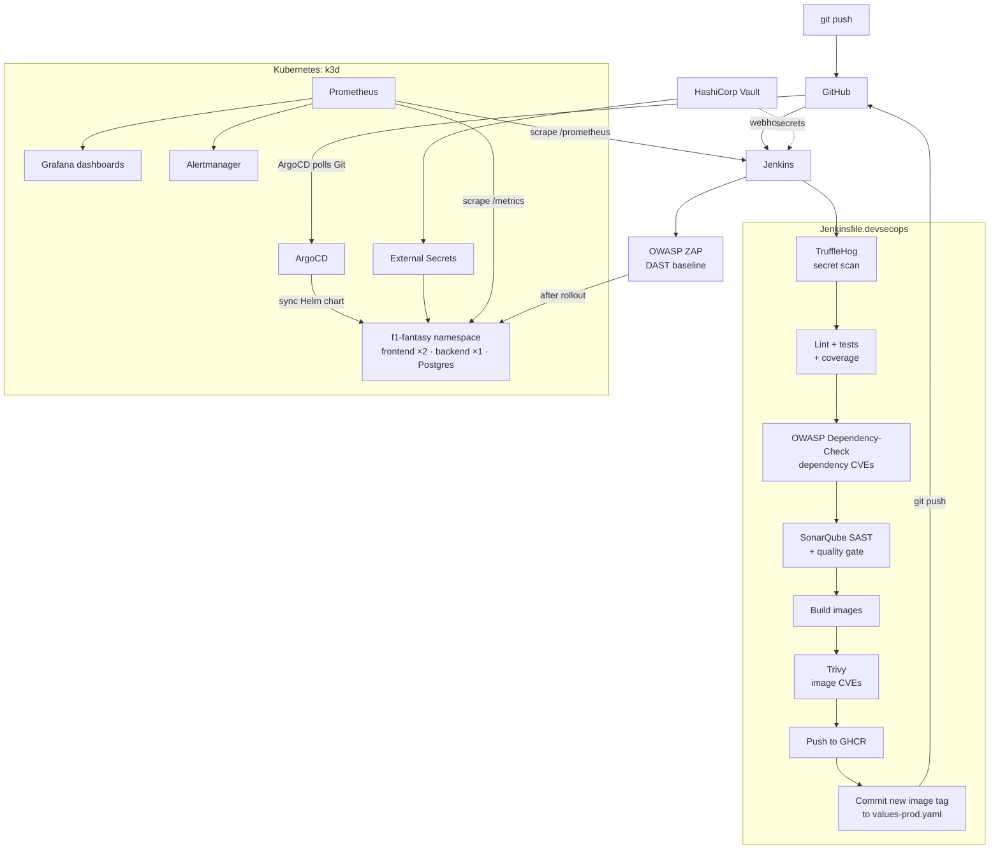

# DevOps

This project's delivery pipeline in two parts:

- **Part A: the pipeline that was built.** GitHub webhooks → Jenkins → SonarQube quality gate → Docker →
  deploy to a server. Set up in May 2026 (v1) and updated in November 2026 (v2) to match the rebuilt app.
- **Part B: the planned DevSecOps platform.** Secret scanning, dependency and image CVE scanning, DAST,
  Kubernetes with Helm, GitOps with ArgoCD, Prometheus/Grafana monitoring and Vault. Every file for it is
  already in `devops/`, marked `STATUS: PLANNED`, and this part explains how to switch each piece on.

## Status at a glance

| Piece | Status | Where |
|---|---|---|
| GitHub Actions CI (lint, tests vs Postgres, typecheck, build) | ✅ Ready (runs on first push) | `.github/workflows/ci.yml` |
| Docker images + Compose stack | ✅ Built and smoke-tested | `Backend/Dockerfile`, `Frontend/Dockerfile`, `docker-compose.yml` |
| Jenkins + SonarQube (Docker) | ✅ v1 used in May 2026; v2 script ready | `devops/jenkins-setup.sh` |
| Jenkins pipeline: webhook → lint/test → SonarQube gate → images → SSH deploy | ✅ v2 ready (not re-run since the rebuild) | `Jenkinsfile`, `sonar-project.properties` |
| Server deploy script | ✅ Ready | `deploy/deploy.sh` |
| TruffleHog, Dependency-Check, Trivy, ZAP | 📋 Planned | `devops/jenkins/Jenkinsfile.devsecops`, `devops/security/` |
| Kubernetes (k3d) + Helm chart | 📋 Planned (chart lints and renders) | `devops/k8s/`, `devops/helm/f1-fantasy/` |
| ArgoCD GitOps | 📋 Planned | `devops/argocd/application.yaml` |
| Prometheus + Grafana + alerts | 📋 Planned (needs the `/metrics` endpoint, see the [metrics contract](#metrics-contract)) | `devops/monitoring/`, `devops/helm/f1-fantasy/templates/monitoring.yaml`, `dashboards/` |
| Vault + External Secrets | 📋 Planned | `devops/vault/` |

---

# Part A: the CI/CD pipeline that was built

## Overview



Everything runs in Docker on the developer machine: Jenkins (`jenkins/jenkins:lts`) and SonarQube
(`sonarqube:lts-community`), both on **host networking** so they reach each other, and the pipeline's throwaway
test database, on `localhost`. Jenkins drives the host's Docker engine through the mounted socket.

## History

### v1 (May 2026)
Built against the original version of the app (the first commit in this repository). How it was set up:

| Date | Step |
|---|---|
| 2026-05-03 | Jenkinsfile and SonarQube config added; Jenkins and SonarQube started in Docker |
| 2026-05-03 | GitHub → Jenkins push webhook configured and tested with trigger commits |
| 2026-05-03 | Pipeline simplified: the redundant checkout stage was removed (declarative pipelines check out automatically) and Node was installed in the Jenkins image instead of a Jenkins tool |
| 2026-05-03 – 05 | Full end-to-end runs, from push through quality gate to deploy on EC2 |

v1 pipeline (`archive/devops-v1/Jenkinsfile`): `npm install` (backend and frontend) → SonarQube analysis →
quality gate → SSH to an AWS EC2 instance (IP hard-coded) → run `~/deploy.sh` there.

### v2 (November 2026): what changed and why

| v1 | v2 | Why |
|---|---|---|
| No tests or lint | Backend lint + 15 tests (unit + integration against a real Postgres) + coverage; frontend lint + typecheck + build | A green build now means the app works, not just that it installs |
| `npm install` | `npm ci` | Reproducible installs from the lockfiles |
| SonarQube with no coverage | `lcov` coverage from `npm run test:coverage` fed to SonarQube | Coverage on the quality gate (backend ≈ 55%, scoring rules 100%) |
| Build triggered by job config | `triggers { githubPush() }` in the Jenkinsfile | Trigger lives in version control |
| No images | Builds `f1-fantasy-backend` and `f1-fantasy-frontend` images tagged with the build number | Same artifacts as production |
| EC2 IP and user hard-coded | `DEPLOY_HOST` / `DEPLOY_USER` / `APP_DIR` parameters; deploy skipped when empty | Reusable for any server; safe to run without one |
| `~/deploy.sh` kept only on the server | `deploy/deploy.sh` in the repo: pull, `docker compose up --build`, health check | Deploy logic reviewed and versioned like code |
| Setup script: fixed `sleep`s, fails on re-run, no Docker CLI in Jenkins | Idempotent, waits for readiness, installs Docker CLI + plugins, fixes socket permissions, checks `vm.max_map_count` | One command to (re)create the CI environment |

The originals are kept in `archive/devops-v1/`.

## Files

| File | Purpose |
|---|---|
| `devops/jenkins-setup.sh` | Creates/starts the Jenkins and SonarQube containers and installs Node 22, SonarScanner, the Docker CLI and plugins inside Jenkins |
| `Jenkinsfile` | The pipeline (declarative) |
| `sonar-project.properties` | What SonarQube analyses: sources, tests, coverage report, exclusions |
| `Backend/Dockerfile`, `Frontend/Dockerfile`, `Frontend/nginx.conf` | Images: Node API (migrates + syncs data on start); static frontend on nginx |
| `docker-compose.yml` | Postgres + API + frontend stack, used locally and by the deploy |
| `deploy/deploy.sh` | Runs on the server: `git reset --hard origin/main`, `docker compose up -d --build`, waits for `/health` |
| `.github/workflows/ci.yml` | GitHub Actions: same checks on every push/PR, independent of Jenkins |

## Setup from scratch

### 1. Start Jenkins and SonarQube
```bash
./devops/jenkins-setup.sh
```
It prints the Jenkins initial admin password. Open http://localhost:8080, install the suggested plugins (the
script already added Pipeline, Git, GitHub, SonarQube Scanner, SSH Agent and Stage View) and create an admin user.

### 2. SonarQube: token, project and webhook
1. Open http://localhost:9000, log in as `admin` / `admin` and set a new password.
2. **My Account → Security → Generate token** (type *Global analysis token*). Copy it.
3. **Administration → Configuration → Webhooks → Create**: name `jenkins`, URL
   `http://localhost:8080/sonarqube-webhook/`. This is how `waitForQualityGate` learns the result; without it
   the Quality gate stage waits until it times out.
4. (Optional) **Quality Gates**: copy *Sonar way* and add a condition such as *Coverage on new code < 50%*.

### 3. Jenkins: connect SonarQube
1. **Manage Jenkins → Credentials → System → Global → Add**: *Secret text*, ID `sonarqube-token`, the token.
2. **Manage Jenkins → System → SonarQube servers**: tick *Environment variables*, add a server named
   **`SonarQube`** (the Jenkinsfile uses this name), URL `http://localhost:9000`, token `sonarqube-token`.

`sonar-scanner` is already on the PATH inside the container, so no Jenkins *tool* entry is needed.

### 4. Jenkins: the pipeline job
**New Item → Pipeline** (`f1-fantasy`):
- *Build Triggers*: **GitHub hook trigger for GITScm polling**. The Jenkinsfile also declares `githubPush()`;
  the first manual build registers it.
- *Pipeline*: **Pipeline script from SCM** → Git → repository URL, branch `*/main`, script path `Jenkinsfile`.
  Add a credential if the repo is private.
- Run **Build with Parameters** once by hand so Jenkins learns the parameters.

### 5. GitHub webhook
GitHub must reach Jenkins over the internet, which a laptop isn't. Expose port 8080 with a tunnel:
```bash
ngrok http 8080            # or: cloudflared tunnel --url http://localhost:8080
```
Then in GitHub: **Settings → Webhooks → Add webhook**:
- Payload URL: `https://<tunnel-host>/github-webhook/` (the trailing slash matters)
- Content type: `application/json`
- Events: *Just the push event*

GitHub sends a ping; a green tick under *Recent Deliveries* means Jenkins answered. Every `git push` now starts a
build. (If Jenkins runs on a server with a public IP, use `http://<server-ip>:8080/github-webhook/` instead.)

### 6. Deploy target (optional)
1. Server: install Docker and Git, `git clone <repo> ~/F1_Fantasy`, create `~/F1_Fantasy/.env` with at least
   `JWT_SECRET` and `JWT_REFRESH_SECRET` (and `SEED_ADMIN_EMAIL` / `SEED_ADMIN_PASSWORD` for an admin).
2. Jenkins: **Credentials → Add → SSH Username with private key**, ID `deploy-ssh-key`.
3. Build with `DEPLOY_HOST=<server ip>`. Builds on `main` then run `deploy/deploy.sh` on the server, which rebuilds
   the stack and fails the build if `/health` doesn't come up within a minute.

## The pipeline, stage by stage (`Jenkinsfile`)

| Stage | What it does | Fails when |
|---|---|---|
| **Backend: lint & test** | Starts `postgres:16-alpine` on port 55499 (host network, `PGPORT`), then `npm ci` → ESLint → `prisma migrate deploy` → `npm run test:coverage`. The database is always removed afterwards (`finally`) | Lint errors, a migration that doesn't apply, any failing test |
| **Frontend: lint, typecheck & build** | `npm ci` → ESLint → `tsc --noEmit` → `vite build` | Lint/type errors, build errors |
| **SonarQube analysis** | `sonar-scanner` with the server URL and token injected by `withSonarQubeEnv('SonarQube')`; uploads code and `Backend/coverage/lcov.info` | Scanner can't reach SonarQube |
| **Quality gate** | Waits (max 5 min) for SonarQube's webhook with the gate result | Gate failed (new bugs, vulnerabilities, coverage below the threshold, …) |
| **Docker images** | Builds both images, tagged `:<build number>` and `:latest` (`--network host` so build steps always have network) | Dockerfile errors |
| **Deploy** | Only on `main` with `DEPLOY_HOST` set: SSH → `deploy/deploy.sh` | Server unreachable, stack doesn't become healthy |
| *post* | Archives `lcov.info` | |

Parameters: `RUN_SONAR` (default on), `BUILD_IMAGES` (default on), `VITE_API_BASE`, `DEPLOY_HOST`,
`DEPLOY_USER`, `APP_DIR`. The pipeline won't run two builds at once, keeps the last 20, and times out after 30 minutes.

### Jenkins credentials
| ID | Type | Used by |
|---|---|---|
| `sonarqube-token` | Secret text | SonarQube server config |
| `deploy-ssh-key` | SSH username + private key | Deploy stage |
| *(repo credential)* | Username + PAT | Checkout, if the repo is private |

## SonarQube configuration (`sonar-project.properties`)
- **Sources:** `Backend/src`, `Backend/index.js`, `Frontend/src`; generated Prisma client, `node_modules` and
  `dist` excluded.
- **Tests:** `Backend/test`. **Coverage:** `Backend/coverage/lcov.info`, produced by Node's built-in coverage
  (`--experimental-test-coverage --test-reporter=lcov`, Prisma's generated code and the tests excluded).
- The frontend is analysed for bugs and code smells but excluded from the coverage figure until it has unit tests.

## GitHub Actions (`.github/workflows/ci.yml`)
Runs the same checks on GitHub's runners for every push and pull request: a Postgres service container, then
backend lint, migrations and tests; frontend lint, typecheck and build. It keeps the repo green even when the
Jenkins machine is off. Jenkins adds what Actions doesn't do here: SonarQube, images and deployment.

## Docker
| Image | Base | Notes |
|---|---|---|
| `f1-fantasy-backend` | `node:22-alpine` | `npm ci --omit=dev`; on start: `prisma migrate deploy` → seed/sync real F1 data → `node index.js`; port 4000 |
| `f1-fantasy-frontend` | `node:22-alpine` build → `nginx:1.27-alpine` | `VITE_API_BASE` is a build arg; SPA fallback; long-cache `/assets`; `sw.js` never cached |

`docker compose up --build` starts Postgres (with a health check and the `db-data` volume), the API (`:4000`) and
the frontend (`:8080`).

## Troubleshooting
| Symptom | Cause / fix |
|---|---|
| Containers can't start: *failed to add the host … pair interfaces: operation not supported* | Kernel updated without a reboot, so Docker's bridge (veth) module can't load. **Reboot.** (Everything in Part A uses host networking and works regardless.) |
| SonarQube exits on start, logs mention `vm.max_map_count` | `sudo sysctl -w vm.max_map_count=262144` (the setup script checks this) |
| Quality gate stage hangs, then times out | SonarQube → Jenkins webhook missing or wrong URL (step 2.3) |
| GitHub webhook shows 403/404 | Missing trailing slash in `/github-webhook/`, the tunnel URL changed (ngrok free URLs change on restart), or the job lacks *GitHub hook trigger* |
| `permission denied … /var/run/docker.sock` in a stage | Jenkins user not in the socket's group; re-run `devops/jenkins-setup.sh` (it adds it and restarts Jenkins) |
| `sonar-scanner: not found` | Jenkins container was recreated; re-run the setup script |
| Tests fail with `ECONNREFUSED :55499` | The throwaway Postgres didn't start; check `docker logs f1-test-<build>`, or port 55499 is taken |

## Evidence to capture (for the README or a portfolio)
Save under `docs/screenshots/devops/`:
1. Jenkins **Stage View** of a green build (all stages).
2. A build **triggered by a GitHub push** ("Started by GitHub push by …").
3. GitHub **Webhooks → Recent Deliveries** with a 200 response.
4. SonarQube **project overview**: quality gate *Passed*, coverage, bugs/vulnerabilities/code smells.
5. A **failed quality gate** stopping the pipeline (shows the gate actually blocks).
6. `docker image ls f1-fantasy-*` output and the app running from `docker compose`.

---

# Part B: planned DevSecOps platform

> Nothing in this part is running yet. All files exist and are marked `STATUS: PLANNED`. The Helm chart lints
> and renders; everything else is a reviewed template to switch on in the order below.

## Target architecture



## Files

```
devops/
├── jenkins/Jenkinsfile.devsecops        full pipeline (replaces /Jenkinsfile when ready)
├── security/
│   ├── dependency-check-suppressions.xml accepted false positives (Dependency-Check)
│   ├── .trivyignore                     accepted image CVEs, each with a reason + review date (Trivy)
│   └── zap-baseline.conf                per-rule WARN/FAIL/IGNORE for the ZAP baseline scan
├── k8s/k3d-cluster.yaml                 local 2-node cluster, ports 80/443 → Traefik ingress
├── helm/f1-fantasy/                     the app as a Helm chart
│   ├── Chart.yaml, values.yaml          local defaults
│   ├── values-prod.yaml                 what ArgoCD deploys; Jenkins bumps the image tags here
│   ├── templates/                       backend, frontend, postgres (StatefulSet), ingress, secret,
│   │                                    monitoring (ServiceMonitor, PrometheusRule, dashboard ConfigMap)
│   └── dashboards/f1-fantasy.json       Grafana dashboard (15 panels)
├── argocd/application.yaml              GitOps: chart on main → namespace f1-fantasy, auto-sync + self-heal
├── monitoring/kube-prometheus-stack.values.yaml  Prometheus, Grafana, Alertmanager (+ Jenkins scrape)
└── vault/
    ├── f1-fantasy-policy.hcl            read-only policy for the app's secrets
    └── external-secret.yaml             Vault → Kubernetes Secret via External Secrets Operator
```

## The DevSecOps pipeline (`devops/jenkins/Jenkinsfile.devsecops`)

| # | Stage | Tool | Gate |
|---|---|---|---|
| 0 | Skip release commits | git | Stops Jenkins' own tag-bump commits (`[skip ci]`) from re-triggering the pipeline in a loop |
| 1 | Secrets scan | **TruffleHog** (Docker) | Any *verified* live secret anywhere in git history |
| 2 | Backend lint & test | ESLint, `node:test`, Postgres | As in Part A |
| 3 | Frontend lint, typecheck, build | ESLint, tsc, Vite | As in Part A |
| 4 | Dependency CVEs | **OWASP Dependency-Check** (Docker, NVD cache volume) | CVSS ≥ 7 not suppressed |
| 5 | SAST | **SonarQube** + quality gate | Gate failed |
| 6 | Build images | Docker | Tagged with the short commit SHA |
| 7 | Image scan | **Trivy** | Fixable HIGH/CRITICAL not in `.trivyignore`; JSON reports archived |
| 8 | Push images | GHCR (`ghcr.io/<user>/f1-fantasy-*`) | main only |
| 9 | GitOps release | git | Rewrites both `tag:` values in `values-prod.yaml`, commits `release: … [skip ci]`, pushes |
| 10 | DAST | **OWASP ZAP** baseline (`zaproxy/zap-stable`) | Rules set to FAIL in `zap-baseline.conf` |
| post | Reports | HTML Publisher | Dependency-Check and ZAP reports linked from every build |

**Deployment is a Git commit.** Jenkins never touches the cluster; ArgoCD sees the new tag in Git and rolls it
out. Rolling back means reverting that commit.

Extra Jenkins setup: plugins `htmlpublisher`, `prometheus` and (optionally) `hashicorp-vault-plugin`; credentials
`ghcr-token` (GitHub PAT, `write:packages`), `github-push` (PAT, `repo`) and `nvd-api-key` (free from
nvd.nist.gov; without it the first Dependency-Check download takes hours).

## Kubernetes + Helm

Local cluster: **k3d** (k3s in Docker). It's free and light (~600 MB), and its built-in Traefik ingress serves
`*.localhost` hostnames with no DNS setup.

```bash
k3d cluster create --config devops/k8s/k3d-cluster.yaml
helm install f1-fantasy devops/helm/f1-fantasy -n f1-fantasy --create-namespace \
  --set backend.image.repository=f1-fantasy-backend --set frontend.image.repository=f1-fantasy-frontend
k3d image import f1-fantasy-backend:latest f1-fantasy-frontend:latest -c f1-fantasy   # local images, no registry
# → http://f1.localhost (app) · http://api.f1.localhost/health
```

What the chart deploys:

| Resource | Notes |
|---|---|
| Backend `Deployment` (1 replica, `Recreate`) + `Service` | Readiness and liveness on `/health` (liveness allows 90 s for the first migrate + data sync); secrets via `envFrom` |
| Frontend `Deployment` (2 replicas) + `Service` | Static nginx, safe to scale |
| Postgres `StatefulSet` + `Service` + PVC | Disable with `postgres.enabled=false` to use a managed database |
| `Secret` | Only when `secrets.existingSecret` is empty; in production it comes from Vault |
| `Ingress` | `f1.localhost` → frontend, `api.f1.localhost` → backend |
| `ServiceMonitor`, `PrometheusRule`, dashboard `ConfigMap` | Behind `monitoring.*` flags |

### Design constraint: one backend replica
The API runs its cron jobs (auto-lock and carry-over, results watcher, data sync, replay cache, reminders) and
the SSE pub/sub **in-process**. Two replicas would run every job twice, and a browser connected to pod A would
miss results published by pod B. Hence `replicas: 1` and `strategy: Recreate`. To scale out later:
1. Move the cron jobs to Kubernetes `CronJob`s (or add leader election with a Postgres advisory lock).
2. Replace the in-memory EventEmitter with Postgres `LISTEN/NOTIFY` or Redis pub/sub, so every pod can fan out
   the same events.
3. Then add an HPA on CPU/request rate.

## GitOps with ArgoCD
```bash
kubectl create namespace argocd
kubectl apply -n argocd -f https://raw.githubusercontent.com/argoproj/argo-cd/stable/manifests/install.yaml
# edit repoURL in devops/argocd/application.yaml, then:
kubectl apply -n argocd -f devops/argocd/application.yaml
kubectl -n argocd get secret argocd-initial-admin-secret -o jsonpath='{.data.password}' | base64 -d
kubectl -n argocd port-forward svc/argocd-server 8081:443   # → https://localhost:8081
```
The Application tracks `devops/helm/f1-fantasy` on `main` with `values.yaml` + `values-prod.yaml`, and uses
**automated sync** with `prune` (removes deleted resources) and `selfHeal` (reverts manual `kubectl` edits). The
demo: push a change, then watch Jenkins build, bump the tag, and ArgoCD roll it out with no manual step.

## Monitoring: Prometheus + Grafana
```bash
helm repo add prometheus-community https://prometheus-community.github.io/helm-charts
helm install kube-prometheus-stack prometheus-community/kube-prometheus-stack \
  -n monitoring --create-namespace -f devops/monitoring/kube-prometheus-stack.values.yaml
# Grafana → http://grafana.localhost (admin / the password in the values file)
```
- **Prometheus** discovers the backend via the chart's `ServiceMonitor` and scrapes Jenkins (Prometheus plugin,
  `/prometheus`) as an extra target.
- **Grafana** loads the *F1 Fantasy* dashboard automatically from the chart's ConfigMap: service health (up,
  requests/s, 5xx rate, live SSE clients), latency p95 by route, requests by status, background job runs,
  results imported and push reminders sent, cached replays, races awaiting results, and Node.js memory and
  event-loop lag. The kube-prometheus-stack also ships cluster dashboards; add a community Jenkins dashboard for
  pipeline metrics.
- **Alerts** (`PrometheusRule`): API down 5 min · 5xx above 5% · p95 latency above 1 s · data sync failed twice
  in 12 h · a race over 24 h past its finish with no results.

### Metrics contract
The only **application change** Part B needs: a `/metrics` endpoint in the backend using `prom-client`, exposing
exactly these names (the dashboard and alerts depend on them):

| Metric | Type | Labels | Where to record |
|---|---|---|---|
| `http_request_duration_seconds` | histogram | `method`, `route` (Express route pattern, not the raw URL), `status` | middleware in `src/app.js` |
| `f1_sse_clients` | gauge | — | `live/raceEvents.js`: +1 on connect, −1 on close |
| `f1_job_runs_total` | counter | `job` (`sync`, `results-watch`, `replay-cache`, `auto-lock`, `reminders`), `result` (`success`/`failure`) | the `guard()` wrappers in `jobs/` |
| `f1_results_imported_total` | counter | — | `sync.service.js` after each imported race |
| `f1_push_notifications_sent_total` | counter | — | `push.service.js` `sendToUser` |
| `f1_replays_cached_total` | gauge | — | `prisma.raceReplay.count()` on scrape |
| `f1_races_awaiting_results_hours` | gauge | — | hours since the oldest race that finished without results |
| default Node.js metrics | | | `collectDefaultMetrics()` (memory, event-loop lag, GC) |

Estimated effort: about 60 lines and one dependency. `/metrics` should be cluster-internal only (no ingress rule).

## Secrets with Vault
```bash
helm repo add hashicorp https://helm.releases.hashicorp.com
helm install vault hashicorp/vault -n vault --create-namespace --set server.dev.enabled=true   # dev mode for the demo
vault kv put secret/f1-fantasy jwt_secret=… jwt_refresh_secret=… postgres_password=… database_url=…
vault policy write f1-fantasy devops/vault/f1-fantasy-policy.hcl
# enable Kubernetes auth with role "f1-fantasy" bound to the namespace, install External Secrets Operator, then:
kubectl apply -f devops/vault/external-secret.yaml
```
External Secrets turns the Vault entry into the `f1-fantasy-secrets` Secret that `values-prod.yaml` points at,
so no secret is ever committed. Jenkins can read the same path with the Vault plugin (`withVault`) instead of
storing secrets as Jenkins credentials.

## Rollout plan
| Phase | Work | Result to show |
|---|---|---|
| 1 | Push to the new repo; GitHub Actions goes green | CI badge |
| 2 | Re-run Part A (setup script, SonarQube, webhook) on the new repo | Stage View + quality gate screenshots |
| 3 | Swap in `Jenkinsfile.devsecops` up to stage 7 (TruffleHog, Dependency-Check, Trivy) | Security reports on each build |
| 4 | k3d + Helm install by hand | App on `http://f1.localhost` |
| 5 | GHCR push + ArgoCD + GitOps stage | Push → automatic rollout |
| 6 | `/metrics` endpoint + kube-prometheus-stack | Grafana dashboard, a test alert firing |
| 7 | ZAP stage, then Vault + External Secrets | DAST report; no secrets in Git or Jenkins |

**Resources:** this machine has 14 GB RAM. Jenkins + SonarQube ≈ 3–4 GB; k3d + app + ArgoCD + monitoring
≈ 4–5 GB. Running everything at once fits but is tight, so demo CI (phases 2–3) and CD/monitoring (4–7) separately.

## What was deliberately left out
- **Maven / Nexus:** Maven builds Java; this is a Node project (npm + lockfiles). Nexus could proxy npm and host
  images, but GHCR is free and enough here.
- **Managed Kubernetes (EKS/AKS/GKE):** k3d shows the same Kubernetes, Helm and ArgoCD workflow at no cost.
  Pointing the ArgoCD Application at a cloud cluster is the only change.
